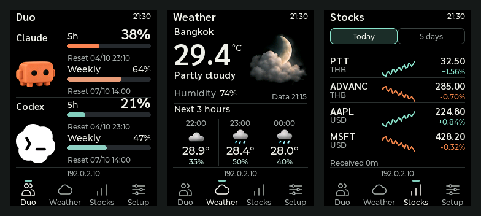

# Desk Duo

An ESP32 desk companion for **Claude & Codex usage, weather, and Thai/US stocks**, with a portrait display, bilingual web admin, and Wi-Fi firmware updates.

Your Mac sends AI usage through CodexBar hooks. The ESP32 fetches weather and stock data directly from configured sources—no Raspberry Pi or central server required.

## Screenshots



**Duo · Weather · Stocks** — actual LVGL UI rendered with sample data from firmware **2.2.3**. These are simulator captures, not device photographs or live market readings. See [image provenance](docs/images/README.md).

| Duo | Weather | Stocks |
| --- | --- | --- |
| Claude and Codex usage, separate windows, and reset times | Current conditions, day/night artwork, and the next three hours | Thai/US quotes, small charts, and Today / 5 days controls |

## Features

- **AI usage:** animated Claude and Codex identities, usage percentages, and reset times for each window.
- **Codex display modes:** show both windows, such as 5h + Weekly, or select Weekly only in the web admin. Available windows depend on the source account.
- **Weather:** current conditions and forecasts with daytime, nighttime, and rain artwork.
- **Stocks:** Thai and US symbols through Yahoo Finance, with sparklines; custom JSON endpoints and Google Sheets are also supported.
- **Web admin:** Display, AI usage, Weather, Stocks, Wi-Fi, and Firmware sections.
- **Thai / English:** selectable interface language on the display and in the web admin.
- **Brightness:** device and web controls, with configurable day/night schedules based on the saved brightness setting.
- **Wi-Fi OTA:** application-only updates, boot rollback, and preserved settings.

## Hardware

- **ESP32-2432S028R (CYD / Cheap Yellow Display)**
- ILI9341 240×320 display in portrait orientation
- 4 MiB flash; no PSRAM required

Firmware uses ESP-IDF and LVGL. Pin assignments and flashing instructions are documented in the [firmware guide](firmware/README.md).

## Downloads

Download firmware from [GitHub Releases](https://github.com/peerapach/desk-duo-monitor/releases). Choose `desk-duo-app.bin` for Wi-Fi OTA. The merged `desk-duo-cyd.bin` is for initial USB installation; it can erase settings on a configured board. Each release includes checksums, migration segments, and third-party notices.

The [Firmware workflow](https://github.com/peerapach/desk-duo-monitor/actions/workflows/firmware.yml) builds and verifies the CYD firmware on relevant pushes to `main`, pull requests, and manual runs. Version tags publish a release after successful validation. See [CI and releases](docs/development.md#github-actions-and-releases).

## Getting started

### 1. Build and install the firmware

Install Python 3.9+ and Git, then run from the repository root:

```sh
python3 -m venv .venv
.venv/bin/python -m pip install -r requirements-build.txt
.venv/bin/python scripts/pio.py run -d firmware -e cyd
.venv/bin/python scripts/package_firmware.py
```

Generated firmware packages are written to `artifacts/`. Follow the [firmware guide](firmware/README.md) for the initial USB installation and migration from older flash layouts.

For a configured device, use **`desk-duo-app.bin`** for Wi-Fi OTA updates. Do not overwrite an existing configuration with a merged initial-install image.

### 2. Connect the display

1. Join the device's `DeskDuo-xxxxxx` Wi-Fi access point.
2. Open `http://192.168.4.1` and enter your Wi-Fi settings.
3. Find the admin password and usage bearer token on the device's Setup page.
4. Once connected, open the device's LAN IP to configure weather, stocks, language, brightness, and display preferences.

### 3. Connect CodexBar

The Mac bridge uses Python's standard library and does **not** require the CodexBar CLI.

Test event normalization without contacting a device:

```sh
python3 bridge/codexbar_sender.py --dry-run < examples/usage-event.json
```

Copy [the bridge config example](examples/bridge-config.example.json) to a private location, fill in your device endpoint and token, and configure CodexBar hooks using [the hook example](examples/codexbar-hooks.example.json). Use absolute executable and script paths in the hook settings.

See the [CodexBar setup guide](docs/codexbar.md) for configuration details. Weather and stock requests stay on the ESP32.

## Repository layout

| Path | Purpose |
| --- | --- |
| `firmware/` | ESP-IDF / LVGL firmware, embedded web admin, artwork, and fonts |
| `bridge/` | Python sender for CodexBar hook events |
| `integrations/google-sheets/` | Optional Apps Script JSON endpoint |
| `examples/` | Sample configuration and response fixtures |
| `scripts/` | Build, packaging, migration, and asset tools |
| `tests/` | Python, Node, portable C++, and native LVGL UI tests |
| `docs/` | Setup, protocol, development, and project status |

## Documentation

- [CodexBar hooks](docs/codexbar.md)
- [Thai/US stocks and charts](docs/stocks.md)
- [Protocol and JSON fields](docs/protocol.md)
- [Development and tests](docs/development.md)

## Configuration and assets

Keep private configuration outside the repository or in ignored `*.local.json` files. Never commit Wi-Fi passwords, admin passwords, or usage tokens. The files under `examples/` contain sample values only.

Generated image and font sources are checked in, so building the firmware does not require regenerating artwork. See the [asset pipeline](firmware/assets/README.md) and [third-party notices](THIRD_PARTY_NOTICES.md) for provenance and component licenses. A license for the project's original code has not yet been selected.
